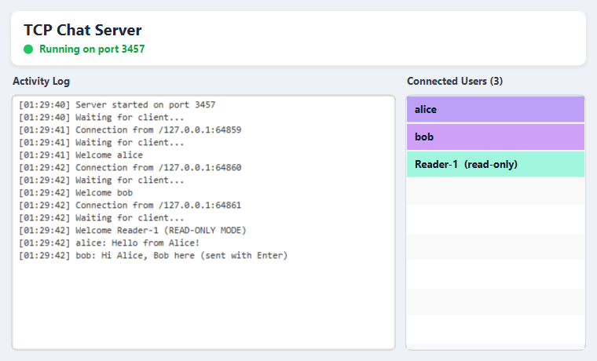
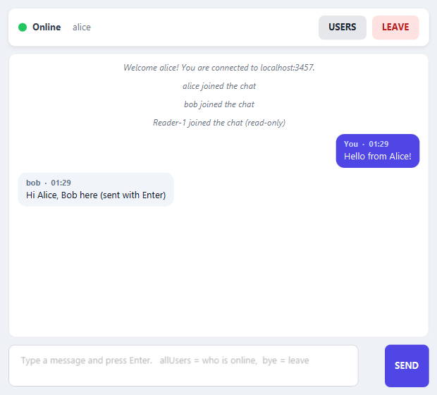
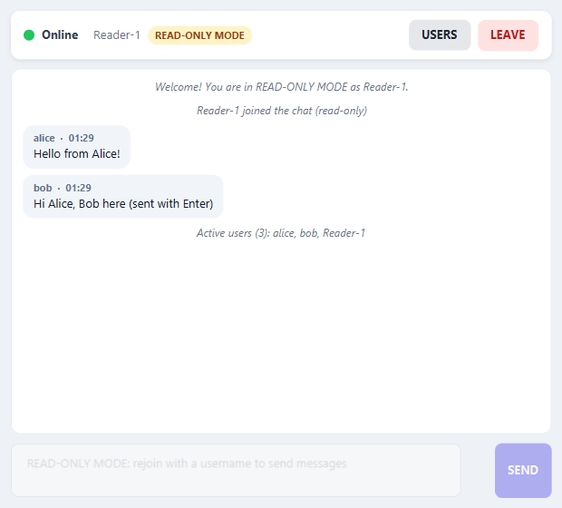
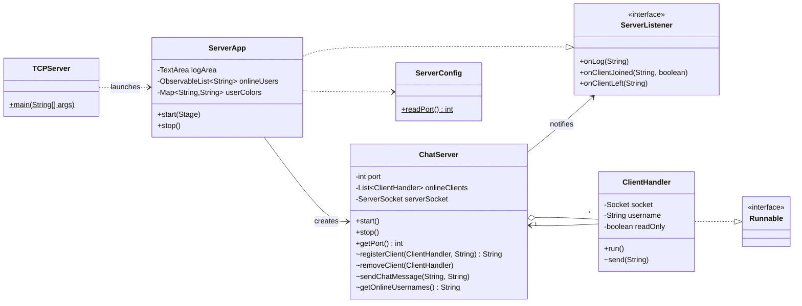
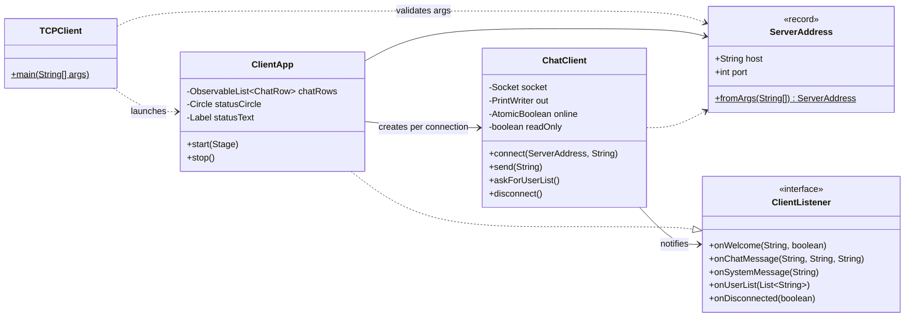
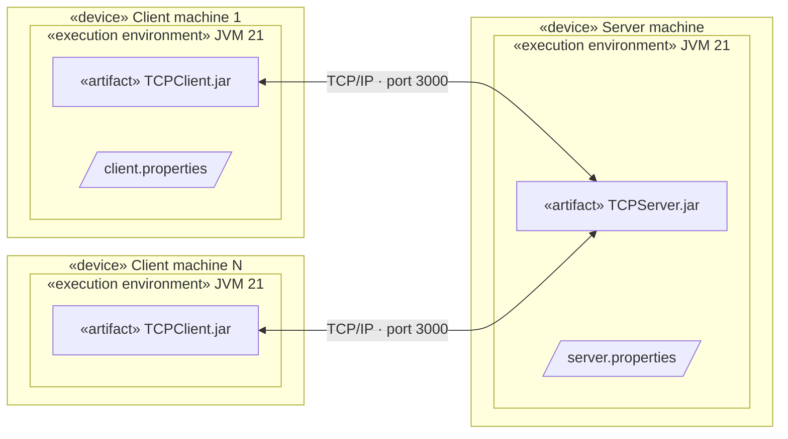
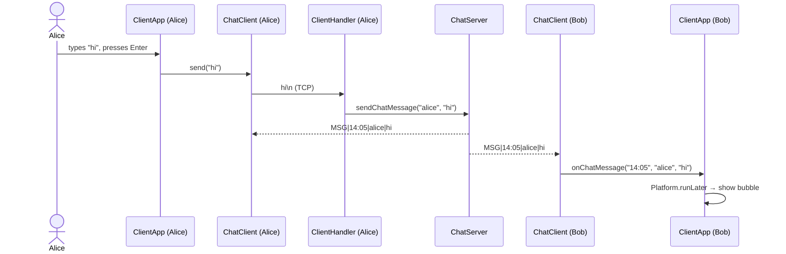

# Multi-Client Chat Application (Java Sockets + JavaFX)

CSC 3374 – Mini Project 1. A group chat built on **TCP sockets**: one central server relays messages between any number of clients. Both sides have a **JavaFX** UI (GridPane layout, CSS styling), the server serves each client on a **virtual thread**, and the networking logic is fully separated from the UI.

| Server | Client (chat) | Client (read-only) |
|---|---|---|
|  |  |  |

## Features

| Requirement | How it is implemented |
|---|---|
| Username before chatting | Login screen; the chat screen only opens after the server's `WELCOME` reply |
| READ-ONLY MODE | Empty username → server assigns `Reader-N`, client disables the input + SEND and shows a badge. The **server also refuses** their messages, so a modified client can't bypass it |
| Real-time messaging | SEND button or **Enter** (Shift+Enter = new line) |
| `allUsers` | Server replies with the active user list **only to the requester** (also available through the USERS button) |
| Disconnect | Typing `end` / `bye` or clicking **LEAVE** sends `bye` to the server, closes the socket and returns to the login screen |
| Status indicator | Green circle + "Online"; turns red + "Offline" if the server goes away |
| Concurrent clients | `ServerSocket.accept()` loop, one **virtual thread** (`Thread.ofVirtual()`) per client |
| Message distribution | Server stamps each message with the sender's username and time (`HH:mm`) and sends it to every connection |
| Live user ListView | Server ListView updates on every join/leave |
| Random colors | Every user gets a random pastel background in the server's list |
| Activity log | "Server started", "Waiting for client...", "Welcome <user>", messages, departures |
| Config file | `server.properties` / `client.properties` are read **at runtime**; a file next to the JAR overrides the bundled one, so no recompilation is needed |
| Model–View separation | `model` packages contain zero JavaFX imports and talk to the UI only through a listener interface |

Also handled: connections that never send a username are dropped after 30 s, duplicate usernames (`alice` → `alice(2)`), sanitized names (protocol separators stripped), message length limit, UTF-8 everywhere, abrupt disconnects (closing the window or killing the process), and a clear error if the server is unreachable or its port is already in use.

## Running

Requires **Java 21+**. The JARs bundle JavaFX, so nothing else is needed.

```bash
# server (port from server.properties, default 3000)
java -jar TCPServer/target/TCPServer.jar

# clients – start as many as you like
java -jar TCPClient/target/TCPClient.jar localhost 3000
java -jar TCPClient/target/TCPClient.jar 192.168.1.20 3000
```

If arguments are omitted, the client falls back to `client.properties`.

### Configuration
To change settings without recompiling, put a properties file in the directory you launch from:

```properties
# server.properties
server.port=3000
```
```properties
# client.properties  (command-line arguments take priority)
server.host=localhost
server.port=3000
```

## Building

Two independent Maven projects:

```bash
mvn -f TCPServer/pom.xml clean package   # -> TCPServer/target/TCPServer.jar
mvn -f TCPClient/pom.xml clean package   # -> TCPClient/target/TCPClient.jar
```

In IntelliJ: right-click each `pom.xml` → *Add as Maven Project*, then run `TCPServer` / `TCPClient` (program arguments `localhost 3000`). The fat JAR is produced by the Maven Shade plugin. `TCPServer`/`TCPClient` are plain launcher classes, not `Application` subclasses, so JavaFX can boot from the classpath.

### Tests
`mvn package` also runs the JUnit 5 tests (11 total). They talk to **real sockets**:
- `ChatServerTest` – real server on a random port + raw protocol clients: broadcast format, `allUsers` privacy, read-only enforcement, `bye`, abrupt disconnect, silent-connection timeout, unique names, config parsing.
- `ChatClientTest` – real `ChatClient` against a fake server: protocol parsing, newline flattening, `end`/`bye`/LEAVE notify the server, read-only blocking, connection loss, unreachable server, address resolution.

## Architecture

```
TCPServer/src/main/java/com/csc3374/server/
├── TCPServer.java            entry point
├── model/                    no JavaFX here
│   ├── ChatServer.java       accept loop, client registry, broadcast
│   ├── ClientHandler.java    one per client, runs on a virtual thread
│   ├── ServerListener.java   model -> view callbacks
│   ├── ServerConfig.java     loads server.properties
│   └── Protocol.java         wire format constants
└── view/ServerApp.java       JavaFX: log + colored user ListView

TCPClient/src/main/java/com/csc3374/client/
├── TCPClient.java            entry point, parses <ServerIPAddress> <PortNumber>
├── model/                    no JavaFX here
│   ├── ChatClient.java       socket, reader thread, commands, protocol parsing
│   ├── ClientListener.java   model -> view callbacks
│   ├── ServerAddress.java    args / client.properties resolution
│   └── Protocol.java
└── view/ClientApp.java       JavaFX: login screen + chat screen
```

**Separation of concerns:** the views implement `ServerListener` / `ClientListener` and call into the model. The models never reference a JavaFX class, so the presentation layer can be replaced (console, web, tests) without modifying the logic. In fact, the unit tests drive both models with no UI at all. Callbacks arrive on background threads, so each view hops onto the JavaFX thread with `Platform.runLater`.

### Protocol
Line-based UTF-8 text, one message per line:

| Direction | Line | Meaning |
|---|---|---|
| C → S | `<username>` (first line) | identify; blank = read-only |
| C → S | `allUsers` / `end` / `bye` / text | command or chat message |
| S → C | `WELCOME\|name\|FULL` or `WELCOME\|name\|READ_ONLY` | assigned (unique) name + mode |
| S → C | `MSG\|HH:mm\|sender\|text` | chat message |
| S → C | `SYS\|text` | join/leave notices, errors |
| S → C | `USERS\|a,b,c` | reply to `allUsers` (requester only) |

### Class diagram





### Deployment diagram



### Sequence: sending a message



## Tech stack
Java 21 (virtual threads, records, switch expressions) · java.net Sockets (TCP) · JavaFX 21 (GridPane + CSS) · Maven (Shade plugin) · JUnit 5 · IntelliJ IDEA
